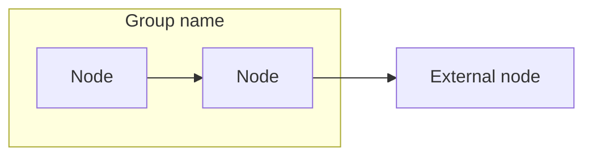

# HTML Presentations — Reference

## Optional Markdown frontmatter

Place at the top of the source `.md`:

```yaml
---
presentation:
  title: "Fireblocks: Legacy → V2"
  lang: es
  eyebrow: "Plataforma ASAP · Fireblocks"
  subtitle: "One-line summary for the opening slide."
  tagline: "Short · punchy · line"
  storage_key: fireblocks-legacy-v2-slide
  scale: 1
  max_slides: 7
  output: ~/.presentations/legacy-to-v2-architecture.html
  slides:
    - type: opening
      source: executive-summary
    - type: diagram-stack
      source: "How It Worked Before (Legacy)"
      mermaid: legacy-flow
    - type: diagram-stack
      source: "How It Works Now (V2)"
      mermaid: v2-flow
    - type: grid-2
      source: "Architectural Improvements"
    - type: status-checklist
      source: "Migration Status"
    - type: bullet-admin
      source: "Treasury Admin"
    - type: comparison-table
      source: Summary
---
```

When `slides:` is present, follow it. Otherwise infer from `##` headings and condense to `max_slides` (default 8).

---

## Slide type catalog

### `opening`

```html
<section class="slide opening" data-index="0">
  <div class="slide-content">
    <p class="eyebrow">…</p>
    <h1>…</h1>
    <p class="subtitle">…</p>
    <span class="tagline">…</span>
  </div>
</section>
```

Map from: document title, executive summary, or frontmatter.

### `diagram-stack`

Diagram on top, two-column bullets, three metric cards below.

```html
<div class="slide-stack">
  <div class="card diagram-card">
    <div class="mermaid-wrap">
      <pre class="mermaid">flowchart LR …</pre>
    </div>
  </div>
  <div class="details-panel details-below">
    <div class="points-columns">
      <ul class="points-col">…</ul>
      <ul class="points-col">…</ul>
    </div>
    <div class="metrics">
      <div class="metric">
        <div class="value legacy-val">3</div>
        <div class="label">…</div>
      </div>
      …
    </div>
  </div>
</div>
```

Use `legacy-val` for “before” metrics, `v2-val` for “after”.

### `grid-2`

Two cards side by side; optional `.closing` paragraph.

### `status-checklist`

`.grid-2` with `.status-grid` (`.dot.active` / `.dot.legacy`) and a `.card` checklist.

### `bullet-admin`

`.slide.slide-admin` with `.intro` + `.admin-list` for feature roadmaps.

### `comparison-table`

`.slide.slide-summary` with `<table>`; use `td.legacy` and `td.v2` for column styling.

---

## Hybrid MD → slide algorithm

1. If frontmatter `presentation.slides` exists → use it.
2. Else split on `##` headings.
3. Merge short adjacent sections if slide count > `max_slides`.
4. Split long sections (multiple `###` + table + mermaid) into multiple slides.
5. Always include opening (from title/summary) and closing comparison if MD has a summary table.

---

## Output path resolution

| Case | Path |
|------|------|
| User provides path | Use as-is |
| Default | `~/.presentations/<basename>.html` |

Example:

```
services/fireblocks/docs/legacy-to-v2-architecture.md
→ ~/.presentations/legacy-to-v2-architecture.html
```

The directory is flat — the source `.md` path is not mirrored. If two decks share the same basename, ask the user for an explicit output path or a distinct filename.

---

## Template placeholders

Replace all `__TOKEN__` values in `assets/presentation-template.html`:

- `__MERMAID_SLIDE_INDEXES__` → literal JSON in JS, e.g. `[1, 2]`
- `__SLIDE_COUNT__` → integer matching number of `<section class="slide">` elements

---

## Mermaid subgraph emphasis (legacy-style)



Post-render: `applyLegacyClusterStyles` colors clusters by order (purple, red, green). Extend `LEGACY_CLUSTER_STYLES` in JS if more than three groups.

**Do not** add:

```
style clusterFg fill:rgba(90,80,249,0.1),...
```

Mermaid parses commas inside `rgba()` as delimiters → syntax error.

---

## Example deck

| Artifact | Path |
|----------|------|
| Source MD | `services/fireblocks/docs/legacy-to-v2-architecture.md` |
| Generated deck | `~/.presentations/legacy-to-v2-architecture.html` |
