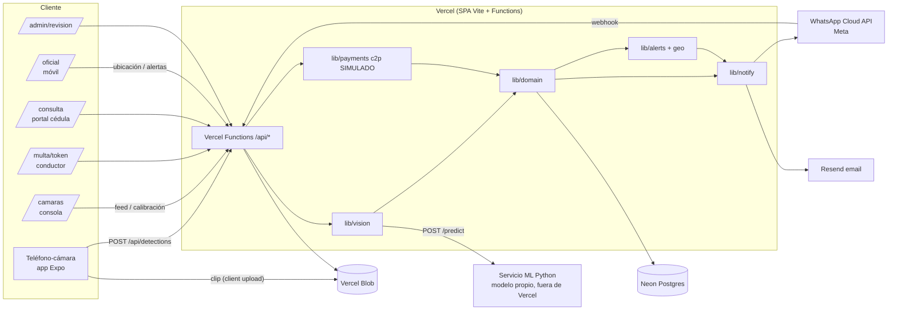
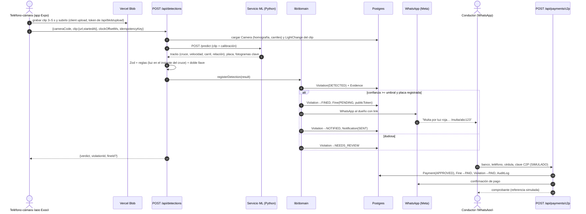
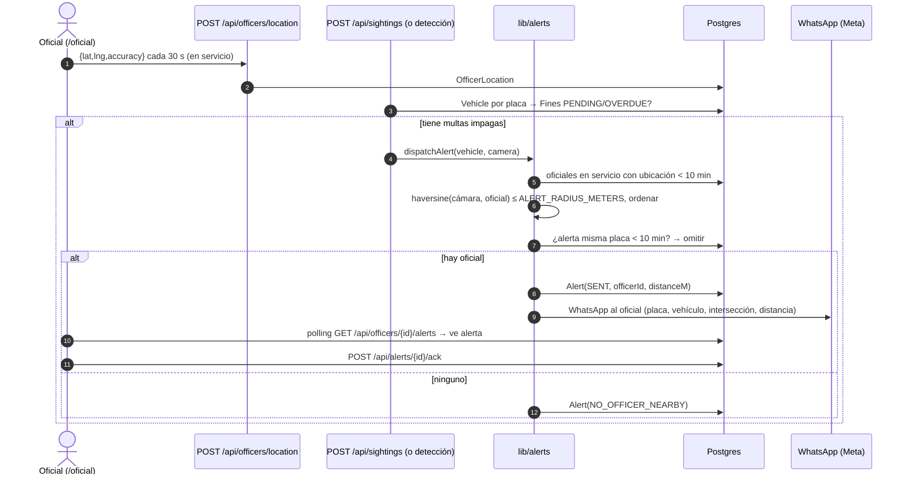

# 02 — Arquitectura · VíaClara

## 1. Componentes
| Componente | Tecnología | Responsabilidad |
|---|---|---|
| Web app | React + Vite (SPA, TypeScript) en Vercel | Todas las pantallas (`src/`) |
| API | Vercel Functions (`api/`, TypeScript, Node) | Endpoints REST; reutilizan `lib/*` |
| Cámara (teléfono) | App Expo en `mobile/` | Graba un clip corto, lo sube a Blob y llama a `/api/detections` con GPS y desfase de reloj |
| Consola de cámaras | `/camaras` (SPA, operador) | Feed en vivo, calibración (homografía, carriles, zona de velocidad), semáforo simulado, sets demo |
| Servicio de inferencia | `ml/` (Python/FastAPI), **fuera de Vercel** | Detector preentrenado afinado, ByteTrack, EasyOCR; homografía, velocidad, carril y dirección |
| Pipeline de visión | `lib/vision/*` en Vercel Function (Node) | Llama al servicio ML, valida con Zod, aplica reglas (luz en el cruce, placa) y doble llave |
| Dominio | `lib/domain/*` | Máquina de estados, creación de multas, deduplicación, auditoría |
| Base de datos | Neon Postgres + Prisma | Persistencia |
| Evidencia | Vercel Blob | Clip, fotogramas clave y recorte de placa (URLs con sufijo aleatorio) |
| Notificaciones | `lib/notify/*` → WhatsApp Cloud API de Meta (línea propia), Resend (email) | Multas, confirmaciones, alertas a oficiales |
| Pagos | `lib/payments/c2p.ts` | **Simulador** de C2P con la misma interfaz que tendría un adaptador bancario real |
| Geo/alertas | `lib/geo`, `lib/alerts` | Oficial más cercano (haversine), anti-spam |

## 2. Diagrama de componentes

## 3. Secuencia: flujo principal (luz roja → pago)

## 4. Secuencia: alerta a oficial

Nota: la ubicación usada para la distancia es la **de la cámara** (GPS del teléfono-cámara; si falta, la de la intersección del seed), no la del ciudadano.

## 5. Pipeline de detección
**Entrada**: un clip corto (3–5 s, ≥ 25–30 fps) grabado por el teléfono-cámara, subido a Blob. La cámara tiene calibración conocida y el semáforo es simulado por el operador (`docs/10` §6).

**Calibración por cámara (seed / editable en `/camaras`)**, geometría de imagen en coordenadas normalizadas 0–1:
- `homography`: 4+ puntos de imagen ↔ puntos del suelo en metros, 2–4 puntos de control y `reprojectionErrorM` (objetivo ≤ 0,15 m).
- `stopLine`: segmento `[[x1,y1],[x2,y2]]`.
- `lanes[]`: polígono del carril, `allowedDirection` (vector en el suelo), `limitKmh` y `limitSource`.
- `speedZone`: `{ yAM, yBM, toleranceKmh }` en metros (base de 15–25 m).
- `parameters`: edad mínima del track, ventana y ángulo de contravía, fotogramas de confirmación (valores de arranque en `docs/10` §3).
- `configVersion`: se incrementa en cada cambio y se guarda con cada detección.

**Pasos (MVP)**:
1. El teléfono sube el clip a Blob (client upload) y llama a `POST /api/detections` con la URL, `startedAt` y `clockOffsetMs`.
2. La función arma la línea de tiempo del semáforo (`LightChange`) para la ventana del clip y llama a `POST {ML_SERVICE_URL}/predict` (contrato en `04-api.md` §8).
3. El servicio decodifica el clip con PTS, detecta y sigue vehículos (ByteTrack), lee la placa (detector + EasyOCR con votación), proyecta el punto inferior central a metros con la homografía y calcula cruce de `stopLine`, velocidad, carril y relación con la dirección permitida. Devuelve fotogramas clave y el recorte de placa.
4. Validación Zod. Si el servicio falla, hace timeout o responde algo inválido → 1 reintento → `NEEDS_REVIEW` (`ML_SERVICE_ERROR`); el clip nunca se pierde.
5. **Reglas** (`lib/vision/rules.ts`): el vehículo objetivo es el track que cruzó `stopLine` (confirmado ≥ 3 fotogramas); se evalúa la luz **en el instante del cruce** con la línea de tiempo del semáforo (amarillo cuenta como verde).
6. **Doble llave**: `VIOLATION` solo si (a) el cruce está confirmado y la luz era `RED` en ese instante, y (b) la placa tiene formato válido con confianza ≥ umbral por votación entre fotogramas. Track con huecos, cambio de ID cerca de la línea o luz que cambia en el instante del cruce → `NEEDS_REVIEW` (`MODEL_RULE_DISAGREE`).
7. Normalizar placa, buscar `Vehicle`. No existe → `NEEDS_REVIEW` (`PLATE_NOT_FOUND`).
8. `lib/domain.registerDetection()` crea registros, deduplica y dispara notificación + chequeo de avistamiento (si el vehículo ya tenía multas impagas, también `dispatchAlert`).

**Velocidad y contravía (estimaciones, no sancionatorias)**: `speedKmh = |yBM − yAM| / Δt × 3,6` con el instante de cruce de cada línea interpolado entre fotogramas; se descarta (`null`) con huecos, oclusión, cambio de ID o fps < 24. La contravía exige desplazamiento > 2 m en una ventana de 1 s, ángulo > 135° contra `allowedDirection` durante 10 chequeos seguidos y edad mínima del track. Se guardan en cada detección; multar por velocidad o contravía es stretch y requiere revisión humana (y, para velocidad, instrumento homologado: `docs/10` §7).

**Alternativas de producción (documentar en pitch, no implementar)**:
- Mismo pipeline en dispositivo edge junto a una cámara real (Jetson o similar), 1080p+ a 25–30 fps reales, obturador 1/1000 s e iluminador IR, poste de 5–8 m.
- Estado del semáforo leído del controlador semafórico (señal eléctrica) en vez de simulado o por visión.
- Velocidad homologada: sellos NTP, evidencia firmada y ensayo contra radar o GNSS (OIML R 91).
- Edge envía solo eventos + recortes al backend; la revisión humana sigue siendo la segunda llave.

## 6. Restricciones de Vercel (honestas)
- Vercel Functions: body máx **4.5 MB** (error 413) → el clip sube por **client upload a Blob** y la función recibe solo la URL. Fuente: https://vercel.com/docs/functions/limitations
- Duración máx en Hobby **300 s** (misma fuente). La inferencia sobre un clip puede tardar varios segundos en CPU; configurar `maxDuration: 60` para `api/detections.ts` en `vercel.json` (`functions`).
- La inferencia **no** corre en Vercel: se sirve desde `ml/` en una máquina del equipo con túnel (ngrok/Cloudflare) o un host gratuito. Si el servicio cae, el flujo cae a `NEEDS_REVIEW`.
- Vercel no procesa video: solo guarda el clip y pasa la URL; el servicio ML lo decodifica.
- Sin WebSockets garantizados en el MVP: "tiempo real" = polling cada 2–3 s (`/api/violations?since=`).
- Región: alinear región de Functions con la de Neon para latencia.

## 7. Seguridad mínima
- La app móvil y el botón de sets demo autentican con `X-Camera-Key` (`CAMERA_API_KEY`); el servicio ML solo acepta `Authorization: Bearer ML_SERVICE_TOKEN`.
- `/camaras`, `/admin/*` protegidos con `ADMIN_PASSCODE` (cookie httpOnly firmada; la validan las funciones de `/api` con `api/_lib/auth.ts` y la SPA redirige a login si recibe 401). `/oficial` con `OFFICER_PASSCODE` + selección de oficial seed.
- Webhook de WhatsApp (Meta): verificar `X-Hub-Signature-256` (HMAC-SHA256 del body crudo con `WHATSAPP_APP_SECRET`) y el `GET` de verificación con `WHATSAPP_VERIFY_TOKEN`.
- `publicToken` de multa: 22+ caracteres aleatorios (nanoid), no secuencial.
- Rate limit en `/api/portal/lookup` y `/api/payments/c2p` (tabla en DB o memoria por instancia; suficiente para demo).

## 8. Variables de entorno
Ver tabla completa en `AGENTS.md` §7.
