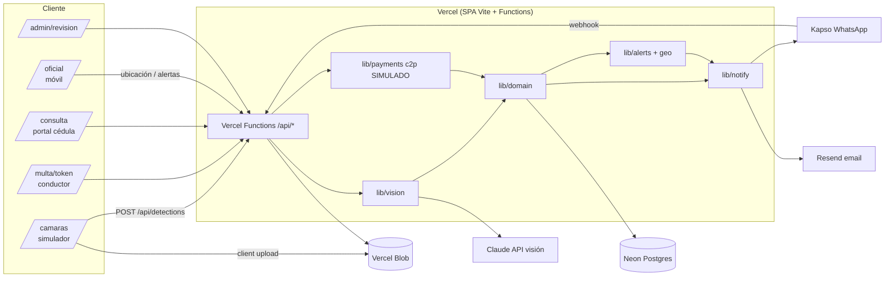
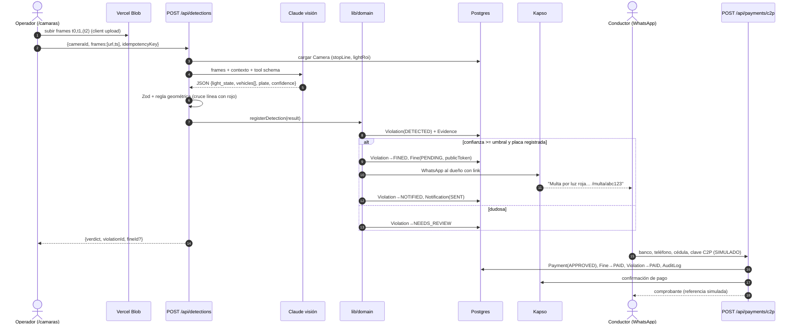
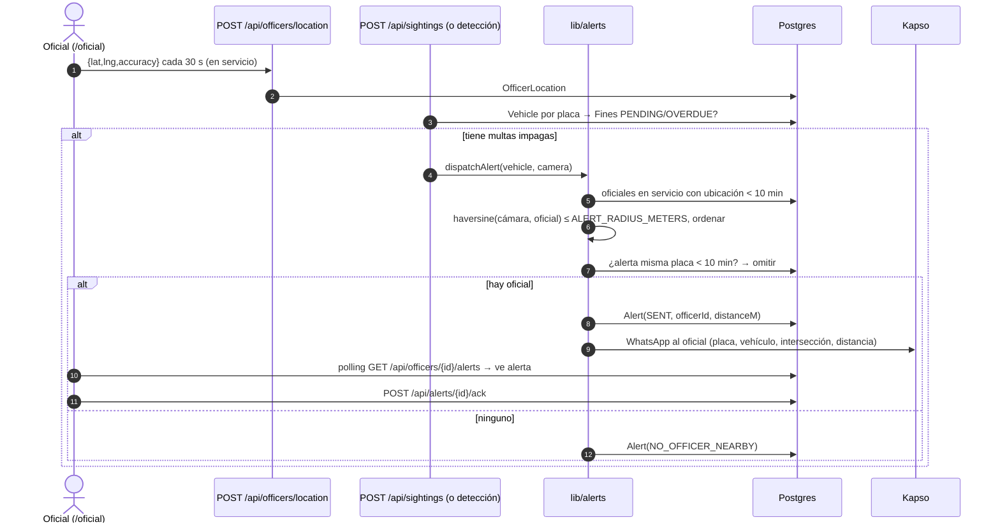

# 02 — Arquitectura · VíaClara

## 1. Componentes
| Componente | Tecnología | Responsabilidad |
|---|---|---|
| Web app | React + Vite (SPA, TypeScript) en Vercel | Todas las pantallas (`src/`) |
| API | Vercel Functions (`api/`, TypeScript, Node) | Endpoints REST; reutilizan `lib/*` |
| Simulador de cámara | `/camaras` (client) | Sube frames a Blob (client upload), dibuja línea de pare, dispara análisis |
| Pipeline de visión | `lib/vision/*` en Vercel Function (Node) | Llama a Claude con frames, valida JSON, aplica regla geométrica |
| Dominio | `lib/domain/*` | Máquina de estados, creación de multas, deduplicación, auditoría |
| Base de datos | Neon Postgres + Prisma | Persistencia |
| Evidencia | Vercel Blob | Frames y recortes de placa (URLs con sufijo aleatorio) |
| Notificaciones | `lib/notify/*` → Kapso (WhatsApp), Resend (email) | Multas, confirmaciones, alertas a oficiales |
| Pagos | `lib/payments/c2p.ts` | **Simulador** de C2P con la misma interfaz que tendría un adaptador bancario real |
| Geo/alertas | `lib/geo`, `lib/alerts` | Oficial más cercano (haversine), anti-spam |

## 2. Diagrama de componentes

## 3. Secuencia: flujo principal (luz roja → pago)

## 4. Secuencia: alerta a oficial

Nota: la ubicación usada para la distancia es la **de la cámara** (donde fue visto el vehículo), no la del ciudadano.

## 5. Pipeline de detección
**Entrada**: 2–3 frames consecutivos (t0 antes de la línea, t1 después) de una cámara con calibración conocida.

**Calibración por cámara (seed / editable en `/camaras`)**, coordenadas normalizadas 0–1:
- `stopLine`: segmento `[[x1,y1],[x2,y2]]`.
- `lightRoi`: rectángulo del semáforo `{x,y,w,h}`.
- `turnArrowRoi`, `turnZone` (stretch), `speedLineA/B` + `distanceMeters` (stretch).

**Pasos (MVP, Claude como "WoW" del hackathon)**:
1. Cliente sube frames a Vercel Blob (client upload; evita el límite de body de 4.5 MB de Vercel Functions) y opcionalmente dibuja la línea de pare encima (overlay rojo) para que el modelo la vea.
2. `POST /api/detections` descarga/usa las URLs y llama a Claude con todos los frames en un mensaje + contexto (ROIs, timestamps) usando **tool use con `input_schema`** para forzar JSON (ver `04-api.md` §Claude).
3. Validación Zod de la salida. Si falla → reintento 1 vez → si falla, `NEEDS_REVIEW` (`VISION_PARSE_ERROR`).
4. **Regla determinista** (`lib/vision/geometry.ts`): punto inferior-central del bbox del vehículo objetivo está del lado "antes" de `stopLine` en t0 y del lado "después" en t1, **y** `light_state(t0) == RED`. Se calcula con producto cruz (signo).
5. **Doble llave**: veredicto final `VIOLATION` solo si regla geométrica **y** `model_says_violation` coinciden y `confidence ≥ umbral` y placa con formato válido. Si discrepan → `NEEDS_REVIEW` (`MODEL_RULE_DISAGREE`).
6. Normalizar placa, buscar `Vehicle`. No existe → `NEEDS_REVIEW` (`PLATE_NOT_FOUND`).
7. `lib/domain.registerDetection()` crea registros, deduplica y dispara notificación + chequeo de avistamiento (si el vehículo ya tenía multas impagas, también `dispatchAlert`).

**Velocidad (stretch)**: v = distanceMeters / (t_cruce_B − t_cruce_A). Requiere timestamps confiables por frame (del simulador) y dos líneas calibradas. Se marca como "estimación demo".

**Alternativas de producción (documentar en pitch, no implementar)**:
- Detección de vehículos con YOLO (u otro detector) + tracking (ByteTrack/SORT) en dispositivo edge junto a la cámara (Jetson o similar).
- ALPR dedicado: OpenALPR / fast-plate-ocr, entrenado con placas venezolanas.
- Estado del semáforo leído directo del controlador semafórico (señal eléctrica) en vez de visión.
- Edge envía solo eventos + recortes al backend; Claude/LLM queda como segundo revisor de casos dudosos.

## 6. Restricciones de Vercel (honestas)
- Vercel Functions: body de request/response máx **4.5 MB** (error 413) → frames a Blob por client upload, la función recibe URLs. Fuente: https://vercel.com/docs/functions/limitations
- Duración máx en Hobby **300 s** (misma fuente). Un análisis con Claude tarda segundos; configurar `maxDuration: 60` para `api/detections.ts` en `vercel.json` (`functions`).
- No hay procesos persistentes ni video en streaming: **no** procesamos video. El simulador extrae frames en el navegador (`<video>` + `<canvas>`, opcional) o usa imágenes pre-grabadas.
- Sin WebSockets garantizados en el MVP: "tiempo real" = polling cada 2–3 s (`/api/violations?since=`).
- Región: alinear región de Functions con la de Neon para latencia.

## 7. Seguridad mínima
- `/camaras`, `/admin/*` protegidos con `ADMIN_PASSCODE` (cookie httpOnly firmada; la validan las funciones de `/api` con `api/_lib/auth.ts` y la SPA redirige a login si recibe 401). `/oficial` con `OFFICER_PASSCODE` + selección de oficial seed.
- Webhook Kapso: verificar HMAC-SHA256 de `X-Webhook-Signature` sobre el body crudo con `KAPSO_WEBHOOK_SECRET`.
- `publicToken` de multa: 22+ caracteres aleatorios (nanoid), no secuencial.
- Rate limit en `/api/portal/lookup` y `/api/payments/c2p` (tabla en DB o memoria por instancia; suficiente para demo).

## 8. Variables de entorno
Ver tabla completa en `AGENTS.md` §7.
