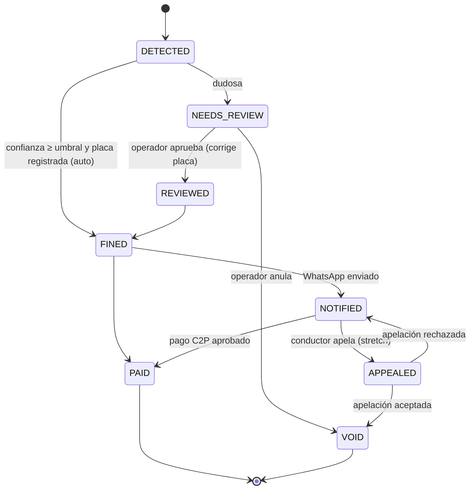

# 03 — Modelo de datos · VíaClara

Dueño: **P1**. Archivo: `prisma/schema.prisma`, seed en `prisma/seed.ts`.

## 1. Entidades
| Entidad | Descripción |
|---|---|
| `Intersection` | Cruce físico (nombre, lat/lng) |
| `Camera` | Cámara (teléfono con app Expo) en una intersección, con calibración (homografía, línea de pare, carriles, zona de velocidad) |
| `LightChange` | Cambio de estado del semáforo simulado de una cámara (con hora del servidor) |
| `Person` | Propietario (cédula, nombre, teléfono, email) — **datos falsos** |
| `Vehicle` | Placa, marca, modelo, color, dueño |
| `Violation` | Evento de infracción detectado (con estado y salida de IA) |
| `Evidence` | Frames y recortes asociados a una violación (URLs Blob) |
| `Fine` | Multa (monto, vencimiento, token público, estado) |
| `Payment` | Intento de pago C2P (simulado) |
| `Notification` | Mensaje enviado (WhatsApp/email) y su estado |
| `Officer` | Oficial (nombre ficticio, teléfono, en servicio) |
| `OfficerLocation` | Última(s) posiciones del oficial |
| `Sighting` | Avistamiento de una placa por una cámara |
| `Alert` | Alerta a oficial por vehículo con deuda |
| `AuditLog` | Registro inmutable de acciones |

## 2. Schema Prisma
```prisma
generator client { provider = "prisma-client-js" }
datasource db {
  provider  = "postgresql"
  url       = env("DATABASE_URL")
  directUrl = env("DIRECT_URL")
}

enum ViolationType   { RED_LIGHT TURN_ARROW SPEEDING }
enum ViolationStatus { DETECTED NEEDS_REVIEW REVIEWED FINED NOTIFIED PAID APPEALED VOID }
enum ReviewReason    { LOW_CONFIDENCE NO_PLATE PLATE_NOT_FOUND MODEL_RULE_DISAGREE ML_SERVICE_ERROR MANUAL }
enum FineStatus      { PENDING PAID OVERDUE APPEALED VOID }
enum PaymentStatus   { PENDING APPROVED REJECTED }
enum Channel         { WHATSAPP EMAIL }
enum NotificationStatus { QUEUED SENT DELIVERED READ FAILED DRY_RUN }
enum AlertStatus     { SENT ACKNOWLEDGED NO_OFFICER_NEARBY SUPPRESSED }
enum EvidenceKind    { CLIP FRAME PLATE_CROP ANNOTATED }
enum ActorType       { SYSTEM OPERATOR OFFICER CITIZEN WEBHOOK }

model Intersection {
  id        String   @id @default(cuid())
  name      String                       // "Av. Ejemplo con Calle Demo" (ficticio)
  lat       Float
  lng       Float
  cameras   Camera[]
}

model Camera {
  id             String   @id @default(cuid())
  code           String   @unique         // "CAM-001"
  intersectionId String
  intersection   Intersection @relation(fields: [intersectionId], references: [id])
  stopLine       Json                     // [[x1,y1],[x2,y2]] normalizado 0-1
  homography     Json                     // {imagePoints, groundPointsM, controlImage, controlGroundM, reprojectionErrorM}
  lanes          Json                     // [{id, polygon, allowedDirection:[dx,dy], limitKmh?, limitSource?}]
  speedZone      Json?                    // {yAM, yBM, toleranceKmh} en metros (base 15-25 m)
  parameters     Json?                    // edad mínima de track, ventana/ángulo de contravía, fotogramas de confirmación
  configVersion  Int      @default(1)     // se incrementa al cambiar la calibración
  refFrameUrl    String?                  // fotograma de referencia (detectar si la cámara se movió)
  speedLimitKmh  Int?                     // límite por defecto si el carril no define uno
  lightChanges   LightChange[]
  active         Boolean  @default(true)
  violations     Violation[]
  sightings      Sighting[]
}

model LightChange {
  id        String   @id @default(cuid())
  cameraId  String
  camera    Camera   @relation(fields: [cameraId], references: [id])
  state     String                        // RED | GREEN (amarillo cuenta como verde)
  at        DateTime @default(now())      // hora del servidor
  @@index([cameraId, at])
}

model Person {
  id        String   @id @default(cuid())
  cedula    String   @unique             // normalizada "V12345678" (FALSA)
  fullName  String
  phone     String                       // E.164 sin "+", ej "584120000001" (FALSO)
  email     String?
  vehicles  Vehicle[]
  createdAt DateTime @default(now())
}

model Vehicle {
  id        String   @id @default(cuid())
  plate     String   @unique             // normalizada "AB123CD" (FALSA)
  make      String
  model     String
  color     String
  year      Int?
  ownerId   String
  owner     Person   @relation(fields: [ownerId], references: [id])
  violations Violation[]
  sightings Sighting[]
  alerts    Alert[]
}

model Violation {
  id             String          @id @default(cuid())
  type           ViolationType
  status         ViolationStatus @default(DETECTED)
  reviewReason   ReviewReason?
  cameraId       String
  camera         Camera          @relation(fields: [cameraId], references: [id])
  vehicleId      String?
  vehicle        Vehicle?        @relation(fields: [vehicleId], references: [id])
  plateRead      String?                 // lo que leyó la IA (normalizado)
  plateConfidence Float?
  confidence     Float                   // confianza global del veredicto
  occurredAt     DateTime
  measuredSpeedKmh Float?                // estimación del servicio ML (requiere homografía y speedZone)
  laneId         String?                 // carril del vehículo
  roadRelation   String?                 // WITH_FLOW | AGAINST_FLOW | UNKNOWN (según la dirección permitida del carril)
  modelVersion   String?                 // versión del modelo ML que produjo la detección
  aiOutput       Json                    // respuesta cruda validada del servicio ML
  ruleOutput     Json                    // resultado regla geométrica
  idempotencyKey String          @unique
  voidReason     String?
  evidence       Evidence[]
  fine           Fine?
  createdAt      DateTime        @default(now())
  updatedAt      DateTime        @updatedAt
  @@index([status])
  @@index([plateRead, cameraId, occurredAt])
}

model Evidence {
  id          String       @id @default(cuid())
  violationId String
  violation   Violation    @relation(fields: [violationId], references: [id])
  kind        EvidenceKind
  url         String                    // Vercel Blob
  capturedAt  DateTime
  meta        Json?                     // bbox, light_state del frame, GPS del teléfono
}

model Fine {
  id           String     @id @default(cuid())
  violationId  String     @unique
  violation    Violation  @relation(fields: [violationId], references: [id])
  publicToken  String     @unique       // nanoid(24)
  amountCents  Int                      // MONTO DE EJEMPLO
  currency     String     @default("VES")
  status       FineStatus @default(PENDING)
  issuedAt     DateTime   @default(now())
  dueAt        DateTime
  paidAt       DateTime?
  payments     Payment[]
  notifications Notification[]
}

model Payment {
  id             String        @id @default(cuid())
  fineId         String
  fine           Fine          @relation(fields: [fineId], references: [id])
  method         String        @default("C2P_SIMULATED")
  status         PaymentStatus @default(PENDING)
  payerBankCode  String                 // "0102" etc. (lista de ejemplo)
  payerPhone     String
  payerCedula    String
  amountCents    Int
  reference      String?                // referencia simulada
  failureCode    String?
  idempotencyKey String        @unique
  createdAt      DateTime      @default(now())
  // NUNCA se guarda la clave C2P
}

model Notification {
  id          String             @id @default(cuid())
  fineId      String?
  fine        Fine?              @relation(fields: [fineId], references: [id])
  alertId     String?
  alert       Alert?             @relation(fields: [alertId], references: [id])
  channel     Channel
  to          String
  template    String                    // "FINE_ISSUED" | "PAYMENT_CONFIRMED" | "OFFICER_ALERT"
  status      NotificationStatus @default(QUEUED)
  providerId  String?                   // wamid de WhatsApp (Meta)
  error       String?
  createdAt   DateTime           @default(now())
  @@index([providerId])
}

model Officer {
  id        String   @id @default(cuid())
  badge     String   @unique            // "OF-0001" (ficticio)
  name      String
  phone     String
  onDuty    Boolean  @default(false)
  locations OfficerLocation[]
  alerts    Alert[]
}

model OfficerLocation {
  id         String   @id @default(cuid())
  officerId  String
  officer    Officer  @relation(fields: [officerId], references: [id])
  lat        Float
  lng        Float
  accuracyM  Float?
  recordedAt DateTime @default(now())
  @@index([officerId, recordedAt])
}

model Sighting {
  id        String   @id @default(cuid())
  cameraId  String
  camera    Camera   @relation(fields: [cameraId], references: [id])
  vehicleId String?
  vehicle   Vehicle? @relation(fields: [vehicleId], references: [id])
  plateRead String
  seenAt    DateTime
  evidenceUrl String?
  alert     Alert?
}

model Alert {
  id          String      @id @default(cuid())
  vehicleId   String
  vehicle     Vehicle     @relation(fields: [vehicleId], references: [id])
  sightingId  String      @unique
  sighting    Sighting    @relation(fields: [sightingId], references: [id])
  officerId   String?
  officer     Officer?    @relation(fields: [officerId], references: [id])
  distanceM   Int?
  unpaidCount Int
  status      AlertStatus
  createdAt   DateTime    @default(now())
  ackAt       DateTime?
  notifications Notification[]
  @@index([vehicleId, createdAt])
}

model AuditLog {
  id         String    @id @default(cuid())
  actorType  ActorType
  actorId    String?
  action     String                    // "VIOLATION_TRANSITION", "PORTAL_LOOKUP", ...
  entity     String                    // "Violation" | "Fine" | ...
  entityId   String?
  before     Json?
  after      Json?
  ip         String?
  createdAt  DateTime  @default(now())
  @@index([entity, entityId])
}
```

## 3. Máquinas de estado
Implementación única en `lib/domain/state-machine.ts`:
```ts
export const VIOLATION_TRANSITIONS: Record<ViolationStatus, ViolationStatus[]> = {
  DETECTED:     ["NEEDS_REVIEW", "FINED", "VOID"],
  NEEDS_REVIEW: ["REVIEWED", "VOID"],
  REVIEWED:     ["FINED", "VOID"],
  FINED:        ["NOTIFIED", "PAID", "APPEALED", "VOID"],
  NOTIFIED:     ["PAID", "APPEALED", "VOID"],
  APPEALED:     ["NOTIFIED", "VOID"],   // apelación rechazada vuelve a NOTIFIED
  PAID:         [],
  VOID:         [],
};
export function transition(v: Violation, to: ViolationStatus, actor: Actor): Promise<Violation>; // lanza InvalidTransitionError; escribe AuditLog en la misma transacción
```

`Fine.status` se sincroniza: `PENDING` mientras Violation ∈ {FINED, NOTIFIED}; `PAID`; `APPEALED`; `VOID`; `OVERDUE` = calculado (`dueAt < now && status=PENDING`), no requiere job.

Nota de alcance: "Revisado" en el brief = `REVIEWED`; en el camino automático se salta (alta confianza), pero el portal y la multa muestran "Verificado automáticamente" vs "Verificado por operador".

## 4. Reglas de dominio (P1)
- **Dedup**: no crear `Violation` si existe otra con mismo `plateRead` + `cameraId` + `type` y `|occurredAt − nueva| < 60 s`. Devuelve la existente (`duplicate: true`).
- **Idempotencia**: `idempotencyKey` = hash(cameraId + URL del clip) si el cliente no envía una.
- **Monto**: tabla de ejemplo en `lib/domain/fines.ts` (`FINE_AMOUNTS_EXAMPLE = { RED_LIGHT: ..., TURN_ARROW: ..., SPEEDING: ... }`), marcada como `// MONTOS DE EJEMPLO, no legales`. `dueAt = issuedAt + 30 días` (ejemplo).
- **Unpaid** = Fines con status `PENDING` (incluye vencidas).

## 5. Seed (datos FALSOS) — `prisma/seed.ts`
Todo con prefijo/indicador de ejemplo. Cédulas en rango claramente ficticio, teléfonos `58412000000X`.
| Tipo | Cantidad | Detalle |
|---|---|---|
| Intersection | 3 | "Av. Demo Norte con Calle 1 (ejemplo)", coords en Caracas aproximadas (zona pública genérica) |
| Camera | 4 | `CAM-001..004`, calibración (homografía y carriles) que coincide con los clips de `public/demo/` |
| Person | 8 | "Persona Ejemplo 1..8", cédulas `V-99000001..V-99000008`, emails `persona1@example.com` |
| Vehicle | 10 | placas `AA000AA`-estilo ficticias (p.ej. `AB123CD`), marca/modelo/color variados |
| Violation+Fine | 12 | historial mixto: PAID, NOTIFIED (vencidas y no), VOID, 2 NEEDS_REVIEW |
| Officer | 3 | `OF-0001..0003`, "Oficial Ejemplo A/B/C"; uno con `phone = DEMO_PHONE_OFFICER` en runtime |
| OfficerLocation | 3 | una cerca (≈ 400 m) de CAM-001, una a ≈ 3 km, una sin ubicación |

**Personajes de demo**:
- `V-99000001` "Persona Ejemplo 1" — dueño de **la placa que aparece en los frames demo** (sin multas previas), teléfono = `DEMO_PHONE_DRIVER` (env, inyectado por el seed si existe).
- `V-99000002` — dueño de placa con **2 multas impagas** → usar para el flujo de alerta a oficial.
- El texto de las placas en los frames demo debe coincidir con el seed (los frames se generan/editan con placas ficticias).

Seed idempotente (`upsert`), ejecutable en Neon de producción para la demo: `pnpm prisma db seed`. Script extra `pnpm demo:reset` que borra violaciones/multas creadas hoy y re-siembra.
